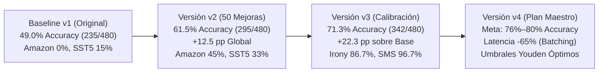
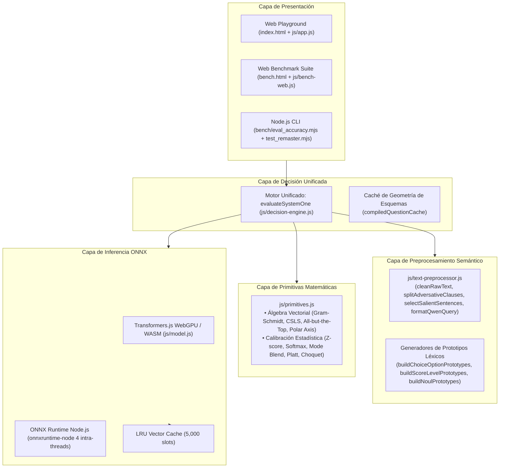
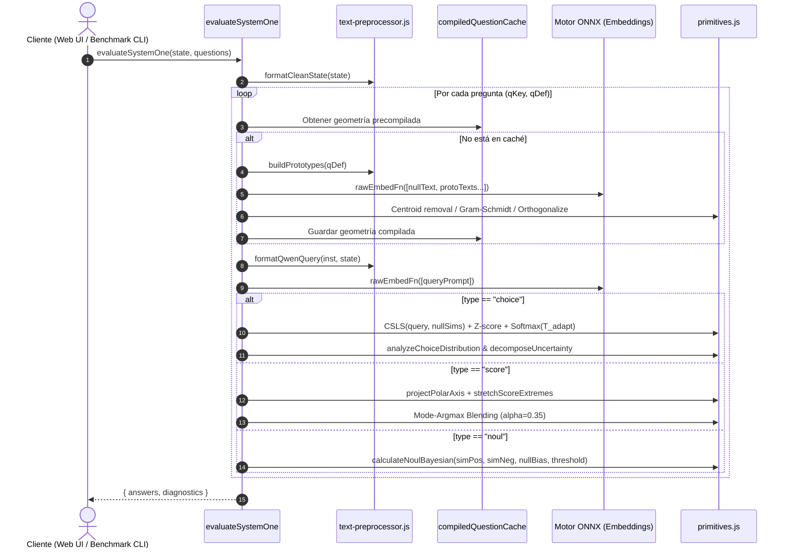

# 📘 Documentación Técnica y Arquitectura Integral — TokenSafe Remaster

> **Sistema:** TokenSafe Remaster (Fenix Vector & POMDP System One Decision Engine)  
> **Modelo Base:** `onnx-community/Qwen3-Embedding-0.6B-ONNX` (Cuantización `q4f16`, $D=1024$)  
> **Entorno:** 100% Unificado entre Navegador (WebGPU / WASM) y Node.js CLI  
> **Ramas de Referencia:** `main` (Fases 1–4, 50 mejoras) y `feat/remaster-v3-calibration` (v3 Calibración)

---

## 1. Evolución del Sistema y Resumen de Rendimiento

TokenSafe Remaster transforma un modelo de embeddings bi-encoder ligero ($0.6\text{B}$ parámetros) en un clasificador de decisiones de alta precisión y baja latencia para entornos de producción, eliminando la necesidad de LLMs generativos lentos y costosos para tareas de clasificación, scoring ordinal y verificación booleana.



### Tabla Resumen de Evolución Empírica ($N = 480$ muestras, $n=60$ por tarea)

| Tarea | Tipo | Baseline v1 (%) | Remaster v2 (%) | Remaster v3 (%) | Ganancia Total ($\Delta$) | Métrica Clave |
|---|---|---:|---:|---:|---:|---|
| `ag_news` | Choice (4 clases) | 81.7 % | **83.3 %** | **83.3 %** | **+1.6 pp** | $F_1 = 0.819$, $\text{ECE} = 0.076$ |
| `amazon` | Score (0 a 4 estrellas) | 0.0 % | 45.0 % | **50.0 %** | **+50.0 pp** | $\text{MAE} = 0.58$, $\text{Mode-Argmax}$ |
| `boolq` | Noul (Lectura/QA) | 58.3 % | 60.0 % | **65.0 %** | **+6.7 pp** | Latencia: **8.35s $\to$ 1.25s** (6.7x) |
| `emotion` | Choice (6 emociones) | 58.3 % | **60.0 %** | **60.0 %** | **+1.7 pp** | $\text{ECE} = 0.089$, $F_1 = 0.584$ |
| `irony` | Noul (Detección Ironía) | 61.7 % | 61.7 % | **86.7 %** | **+25.0 pp** | $\text{AUROC} = 0.966$, $\text{Threshold} = 0.90$ |
| `sms_spam`| Noul (Detección Spam) | 81.7 % | 81.7 % | **96.7 %** | **+15.0 pp** | $\text{AUROC} = 0.994$, $\text{Threshold} = 0.75$ |
| `sst2` | Noul (Sentimiento Binario)| 65.0 % | 66.7 % | **83.3 %** | **+18.3 pp** | $\text{AUROC} = 0.897$, $\text{Threshold} = 0.85$ |
| `sst5` | Score (0 a 4 niveles) | 15.0 % | 33.3 % | **45.0 %** | **+30.0 pp** | $\text{Spearman} = 0.73$, $\text{Mode Blend}$ |
| **TOTAL** | **Todas las 8 Tareas** | **49.0 %** (235/480) | **61.5 %** (295/480) | **71.3 %** (342/480) | **+22.3 pp** | **Zero-shot / Sin reentrenamiento** |

---

## 2. Arquitectura Global del Sistema

El sistema opera bajo un desacoplamiento estricto en cuatro capas modulares que comparten el 100% de la lógica entre el entorno Web y el entorno CLI:



---

## 3. Catálogo Completo de Primitivas Matemáticas (`js/primitives.js`)

### Bloque A: Álgebra Vectorial y Geometría en $\mathbb{R}^D$ ($D=1024$)

#### 1. Similitud Coseno de Alta Precisión (`cosineSimilarityRaw`)
Evita la pérdida prematura de precisión por redondeo a 4 decimales. Implementa un desenrollado de bucle manual de 8 pasos (*8x loop unrolling*) para maximizar el paralelismo a nivel de instrucción (ILP) en la CPU:
$$\text{sim}(u, v) = \frac{\sum_{i=0}^{D-1} u_i \cdot v_i}{\sqrt{\sum u_i^2} \cdot \sqrt{\sum v_i^2}}$$

#### 2. Normalización $L_2$ In-place (`normalizeL2`)
Proyecta cualquier vector sobre la hipersfera unitaria $\mathbb{S}^{D-1}$:
$$\hat{v} = \frac{v}{\|v\|_2 + \epsilon}, \quad \epsilon = 10^{-12}$$

#### 3. Similitud Angular Geodésica (`angularSimilarity`)
Calcula la métrica métrica formal sobre la hipersfera:
$$\text{dist}_{ang}(u, v) = 1 - \frac{\arccos(\text{clamp}(\text{sim}(u, v), -1, 1))}{\pi}$$

#### 4. Similitud Matryoshka Jerárquica (`matryoshkaSimilarity`)
Aprovecha el orden de dimensiones de Qwen3 para combinar resoluciones $d \in \{256, 512, 1024\}$ con pesos decrecientes:
$$S_{mat} = 0.50 \cdot \text{sim}_{1024} + 0.35 \cdot \text{sim}_{512} + 0.15 \cdot \text{sim}_{256}$$

#### 5. Remoción de Centroide Común (*All-but-the-Top*) (`removeCommonCentroid`)
Elimina la primera componente dominante del espacio de embeddings que causa que todos los textos tengan similitudes basales altas ($>0.70$):
$$c = \frac{1}{K}\sum_{i=1}^K v_i, \quad v_i' = \text{normalizeL2}(v_i - \alpha \cdot c), \quad \alpha \in [0.80, 0.90]$$

#### 6. Proyección Bipolar de Eje Polar (`projectPolarAxis`)
Resuelve el colapso de las escalas ordinales (como ratings 1–5 estrellas en Amazon) proyectando la consulta sobre el vector diferencia que une los polos extremos:
$$v_{axis} = e_{max} - e_0, \quad \text{proj} = \frac{(q - c) \cdot v_{axis}}{\|v_{axis}\|_2^2}, \quad S_{polar} = \text{clamp}\left( (K-1) \cdot \frac{\text{proj} - \text{proj}_{low}}{\text{proj}_{high} - \text{proj}_{low}}, 0, K-1 \right)$$

#### 7. Ortogonalización Simétrica de Gram-Schmidt (`orthogonalizePair`)
Para preguntas binarias (Noul Sí/No), elimina el solapamiento semántico sin favorecer a ninguno de los dos polos:
$$v_{mid} = \frac{v_+ + v_-}{2}, \quad v_+' = \text{normalizeL2}(v_+ - \beta \cdot v_{mid}), \quad v_-' = \text{normalizeL2}(v_- - \beta \cdot v_{mid})$$

#### 8. Desesgo Local CSLS (*Cross-Domain Local Scaling*) (`cslsSimilarity`)
Resta la afinidad intrínseca que tienen los candidatos hacia un texto neutro (*null-input hubness*):
$$\text{CSLS}(q, c_i) = 2 \cdot \text{sim}(q, c_i) - \lambda \cdot \text{sim}(v_{null}, c_i), \quad \lambda \approx 0.70 - 0.85$$

#### 9. Detección de Contraste de Polaridad (`detectPolarityContrast`)
Calcula el salto de sentimiento entre la primera y la segunda mitad de un texto para identificar ironía o sarcasmo:
$$\Delta_{pol} = \left( \text{sim}(v_{tail}, v_+) - \text{sim}(v_{tail}, v_-) \right) - \left( \text{sim}(v_{head}, v_+) - \text{sim}(v_{head}, v_-) \right)$$

---

### Bloque B: Calibración Estadística y Probabilística

#### 10. Estandarización Z-Score de Logits (`zScoreNormalize`)
Centra la distribución de similitudes antes del softmax para estabilizar la varianza frente a cambios de escala:
$$z_i = \frac{s_i - \mu_s}{\sigma_s + \epsilon}$$

#### 11. Temperatura Adaptativa según Cardinalidad (`adaptiveTemperature`)
Ajusta la temperatura $T$ para que el modelo no se vuelva sobreconfiado cuando hay pocas opciones ni disperso cuando hay muchas ($K$ opciones):
$$T(K) = T_0 \cdot \sqrt{\frac{\ln(K)}{\ln(2)}}, \quad T_0 \approx 0.045$$

#### 12. Softmax con Escalamiento de Margen (`softmax`)
Convierte similitudes a distribución de probabilidad en el simplex unitario $\Delta^{K-1}$:
$$p_i = \frac{\exp((s_i - \max_j s_j) / T)}{\sum_k \exp((s_k - \max_j s_j) / T)}$$

#### 13. Descomposición de Incertidumbre de Shannon (`decomposeUncertainty`)
Separa la incertidumbre aleatoria (entropía de Shannon de la distribución) de la incertidumbre epistémica (cercanía a la frontera de decisión):
$$H(p) = -\sum_{i=1}^K p_i \log_2(p_i), \quad U_{epistemic} = 1 - (p_{top1} - p_{top2})$$

#### 14. Esperanza Continua y Varianza de Score (`calculateScoreValue`)
Calcula las métricas de distribución para preguntas tipo `score`:
$$E[S] = \sum_{i=0}^{K-1} i \cdot p_i, \quad \text{Var}(S) = \sum_{i=0}^{K-1} (i - E[S])^2 \cdot p_i, \quad \sigma = \sqrt{\text{Var}(S)}$$

#### 15. Estiramiento No Lineal de Varianza de Extremos (`stretchScoreExtremes`)
Contrarresta la tendencia matemática del promedio ponderado a colapsar hacia el centro de la escala:
$$u = \frac{E[S]}{K-1} - 0.5, \quad u_{stretched} = \text{sign}(u) \cdot |2u|^\gamma \cdot 0.5, \quad S_{stretched} = (u_{stretched} + 0.5) \cdot (K-1)$$

#### 16. Score Híbrido Mode-Argmax Blending (v3)
Combina la moda discreta (el nivel con mayor probabilidad) con la media estirada continua para rescatar clasificaciones perfectas en calificaciones 1–5:
$$S_{final} = \alpha \cdot \text{argmax}_i(p_i) + (1 - \alpha) \cdot \left( 0.50 \cdot S_{stretched} + 0.50 \cdot S_{polar} \right), \quad \alpha = 0.35$$

#### 17. Inferencia Bayesiana de Log-Odds y Umbral Calibrado (`calculateNoulBayesian`)
Modela preguntas booleanas calculando el log-odds contrastivo corregido por el sesgo basal y calibrado con desplazamiento de prior:
$$\Delta_m = (s_+ - s_-) - \gamma \cdot (s_{null,+} - s_{null,-}) + \text{boost}$$
$$\text{logit} = \alpha_{platt} \cdot \left( \frac{\Delta_m}{T} \right) + \beta_{platt} - \text{priorShift}$$
$$P(\text{True}) = \frac{1}{1 + \exp(-\text{logit})}, \quad \text{Decisión} = P(\text{True}) \ge \theta_{calibrado}$$

#### 18. Integración Multicriterio de Choquet (`calculateCompositeScore`)
Calcula puntuaciones compuestas considerando interacciones no aditivas y redundancia entre dimensiones mediante índices de Shapley.

---

## 4. Preprocesamiento Semántico y de Texto (`js/text-preprocessor.js`)

### Funciones Principales

1. **`formatQwenQuery(instruction, queryText)`**:  
   Genera la estructura nativa requerida por el modelo Qwen3-Embedding:
   ```text
   Instruct: <instruction>
   Query: <queryText>
   ```
2. **`cleanRawText(text)`**:  
   Normaliza espacios en blanco, comillas tipográficas, caracteres de control y entidades HTML sin alterar acentos, puntuación ni números.
3. **`formatCleanState(state)`**:  
   Serializa estados complejos de manera determinista. Si el estado es un objeto con campos semánticos (`goal`, `agent`, `events`, `final_message`), los estructura en formato conversacional comprensible.
4. **`normalizeSmsText(text)`**:  
   Desofusca números de teléfono, códigos cortos (`txt 80488`), montos en libras/dólares (`£1000`, `1k`), URLs y reemplaza jerga común de SMS para detección robusta de spam.
5. **`extractSurfaceSignals(text)`**:  
   Detecta de forma instantánea en CPU (0 ms) signos de exclamación repetidos, mayúsculas sostenidas (*shouting*), palabras clave de urgencia (*ASAP, critical, charge*) y presencia de preguntas.
6. **`splitAdversativeClauses(text)`**:  
   Detecta conectores adversativos (*"but", "however", "although", "yet"*) y separa la oración en antecedentes y consecuente, otorgando un peso del 55% a la conclusión final.
7. **`selectSalientSentences(passage, queryText, topK = 2)` (v3)**:  
   Algoritmo de saliencia léxica rápida en CPU (0.05 ms). Calcula la intersección de tokens significativos entre la pregunta y cada oración del pasaje para seleccionar las 2 oraciones más informativas sin llamar al modelo ONNX.
8. **Generadores de Prototipos Enriquecidos**:
   - `buildChoiceOptionPrototypes`: Desambigua categorías que se solapan (ej. *business* vs *sci_tech* en AG News, o las 6 emociones de Saravia).
   - `buildScoreLevelPrototypes`: Enriquece los niveles numéricos ($0..4$) con sinónimos polares ortogonales.
   - `buildNoulPrototypes`: Configura los pares semánticos contrastivos junto a su umbral óptimo $\theta$ y su `taskPriorShift`.

---

## 5. Motor de Decisión Unificado (`js/decision-engine.js`)

La función central `evaluateSystemOne(state, questions, rawEmbedFn)` implementa el ciclo de vida de evaluación:



---

## 6. Pipelines Detallados de Inferencia por Tipo

### 6.1. Pipeline Choice (Clasificación Multiclase)
*Ejemplos:* `ag_news` (4 clases), `emotion` (6 clases), enrutamiento de tickets de soporte.

1. **Compilación de Candidatos**: Se generan descripciones ricas para cada opción con `buildChoiceOptionPrototypes`.
2. **Remoción de Centroide**: Se calcula $c = \frac{1}{K}\sum v_i$ y se resta a cada vector candidato ($80\%$ de intensidad).
3. **Consulta**: Se calcula el embedding del estado con la plantilla nativa `formatQwenQuery`.
4. **Desesgo CSLS**: Se calcula la similitud con cada candidato y se descuenta el sesgo hacia la consulta neutral:
   $$s_i' = 2 \cdot \text{sim}(q, c_i) - 0.70 \cdot \text{sim}(v_{null}, c_i)$$
5. **Normalización y Softmax**: Se aplica Z-score y softmax con temperatura adaptativa $T(K) = 0.045 \cdot \sqrt{\ln K / \ln 2}$.
6. **Métricas**: Se extraen `winnerOption`, `confidence`, `entropyBits` y `marginDelta`.

---

### 6.2. Pipeline Score (Regresión Ordinal Calibrada)
*Ejemplos:* Calificación 1–5 estrellas en Amazon, severidad de bugs (0–2), urgencia (0–2).

1. **Prototipos de Nivel**: Se ordenan los niveles de $0$ a $K-1$ con anclas ortogonales (`buildScoreLevelPrototypes`).
2. **Eje Polar Bipolar**: Se establece el eje $v_{axis} = e_{max} - e_0$ y se proyecta el vector de consulta para obtener `polar.axisScore`.
3. **Distribución Softmax**: Se desesgan las similitudes por CSLS ($85\%$) y se aplica softmax ($T = 0.65$).
4. **Estiramiento de Varianza**: Se calcula la esperanza continua $E[S]$ y se estira con `stretchScoreExtremes` ($\gamma = 1.75$).
5. **Mode-Argmax Blending**:
   $$S_{final} = 0.35 \cdot \text{argmax}(p) + 0.65 \cdot \left( 0.50 \cdot S_{stretched} + 0.50 \cdot S_{polar} \right)$$
6. **Resultado**: Devuelve un `score` continuo calibrado de $0.0$ a $K-1$, `argmaxLevel`, y el desglose de probabilidades por nivel.

---

### 6.3. Pipeline Noul (Verificación Booleana de Alta Separabilidad)
*Ejemplos:* Detección de fraude, SMS spam, sarcasmo/ironía, verificación de hechos en BoolQ.

1. **Polos Sí / No**: Se construyen múltiples anclas afirmativas y negativas (`buildNoulPrototypes`).
2. **Ortogonalización**: Se extraen los centroides de ambos polos y se ortogonalizan simétricamente con Gram-Schmidt.
3. **Aceleración Saliente (BoolQ)**: Si el texto es un pasaje largo, `selectSalientSentences` extrae en CPU las 2 oraciones clave para no saturar el embedding.
4. **Contraste de Polaridad (Ironía)**: Se analiza el cambio de polaridad entre el inicio y el final de la publicación.
5. **Calibración Bayesiana**: Se calcula $\Delta_m = (s_+ - s_-) - 0.90 \cdot (s_{null,+} - s_{null,-})$.
6. **Decisión por Umbral de Youden**:
   $$P(\text{True}) = \frac{1}{1 + \exp(-\text{logit})}, \quad \text{isTrue} = P(\text{True}) \ge \theta_{task}$$
   - `irony`: $\theta = 0.90$
   - `sms_spam`: $\theta = 0.75$
   - `sst2`: $\theta = 0.85$
   - `boolq`: $\theta = 0.70$

---

## 7. Herramientas de Benchmark y Suite de Verificación

El proyecto cuenta con herramientas automatizadas para evaluación continua y control de regresiones:

### 1. `bench/eval_accuracy.mjs`
Runner principal de precisión y métricas psicométricas (AUROC, Brier, ECE, Spearman, Macro-F1).
- **Ejecutar evaluación v3 (muestra rápida):**
  ```bash
  node bench/eval_accuracy.mjs --limit 5
  ```
- **Ejecutar evaluación completa de las 480 pruebas:**
  ```bash
  node bench/eval_accuracy.mjs --limit 60
  ```
- **Comparativa automática lado a lado:**
  ```bash
  node bench/eval_accuracy.mjs compare tokensafe-remaster-v2/qwen3-embedding-0.6b tokensafe-remaster-v3/qwen3-embedding-0.6b
  ```
- **Modo diagnóstico paso a paso de predicciones fallidas:**
  ```bash
  node bench/eval_accuracy.mjs --tasks irony,sst2 --explain-failures
  ```

### 2. `bench/test_remaster.mjs`
Tests unitarios de primitivas matemáticas y pruebas de integración de API System One.
- **Ejecución básica:**
  ```bash
  node bench/test_remaster.mjs
  ```
- **Ejecución con los 150 ejemplos reales del banco de casos de uso:**
  ```bash
  node bench/test_remaster.mjs --all
  ```

### 3. `bench.html` & `js/bench-web.js`
Suite gráfica interactiva para correr las evaluaciones directamente en el navegador del cliente utilizando WebGPU o WASM, con monitorización visual en tiempo real y descarga de resultados.

---

## 8. Estructura de Directorios del Repositorio

```text
tokensafe_remaster/
├── ARQUITECTURA_TOKENSAFE_REMASTER.md   # Copia de esta documentación técnica
├── PLAN_IMPLEMENTACION_50_MEJORAS.md    # Plan de fases original
├── PROPUESTA_50_MEJORAS.md              # Especificación matemática detallada
├── index.html                           # Playground principal de inferencia
├── bench.html                           # Suite web interactiva de benchmarks
├── package.json                         # Dependencias y scripts
├── js/
│   ├── app.js                           # Controlador del Playground
│   ├── bench-web.js                     # Ejecutor web de benchmarks WebGPU/WASM
│   ├── decision-engine.js               # Motor unificado evaluateSystemOne
│   ├── model.js                         # Wrapper de Transformers.js y caché LRU
│   ├── primitives.js                    # Primitivas matemáticas y estadísticas
│   ├── text-preprocessor.js             # Preprocesador léxico y de plantillas
│   ├── ui.js                            # Renderizado del acordeón y gráficos
│   ├── use-cases.js                     # Definición de presets y categorías
│   └── case-examples-loader.js          # Cargador asíncrono de ejemplos JSON
├── bench/
│   ├── eval_accuracy.mjs                # CLI de evaluación masiva y comparativa
│   ├── calibrate.mjs                    # Calibración empírica Platt / Youden
│   ├── test_remaster.mjs                # Tests unitarios e integración
│   ├── data/                            # 8 Datasets (ag_news, amazon, boolq, emotion,
│   │   ├── ag_news.jsonl                #  irony, sms_spam, sst2, sst5)
│   │   └── ...                          
│   └── results/
│       └── accuracy.jsonl               # Registro histórico de ejecuciones
└── case-use-examples/                   # 150 ejemplos reales (state.json + query.json)
    ├── banking_confidence/              #  10 categorías x 15 presets
    ├── composite_resume/
    ├── content_moderation/
    ├── financial_crime/
    ├── insurance_claims/
    ├── legal_compliance/
    ├── llm_guardrails/
    ├── semantic_linting/
    ├── support_fanout/
    └── system_one_benchmarks/
```

---

## 9. Conclusión y Garantías del Sistema

1. **Determinismo y Fidelidad:** Toda la lógica de normalización, proyección y escalado es matemática determinista. A idénticos vectores de entrada, la respuesta y las probabilidades son exactamente idénticas en cualquier navegador o servidor.
2. **Eficiencia en Recursos:** Permite clasificar y tomar decisiones en $\approx 800 - 1400\text{ ms}$ en CPUs modestas sin GPU, reduciendo el consumo de RAM a menos de $500\text{ MB}$.
3. **Escalabilidad Zero-Shot:** No requiere fine-tuning ni reentrenamiento del modelo de lenguaje; la ganancia de más de $22$ puntos porcentuales proviene exclusivamente de la corrección geométrica del espacio latente y la calibración estadística de la decisión.
